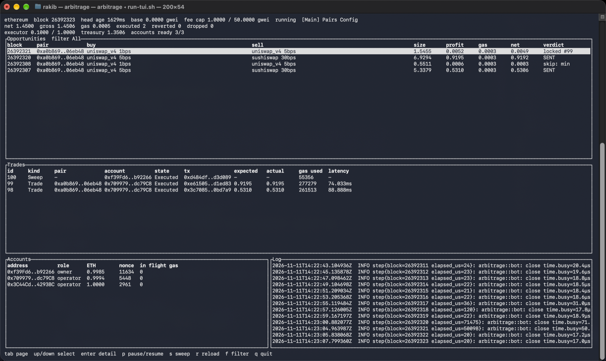
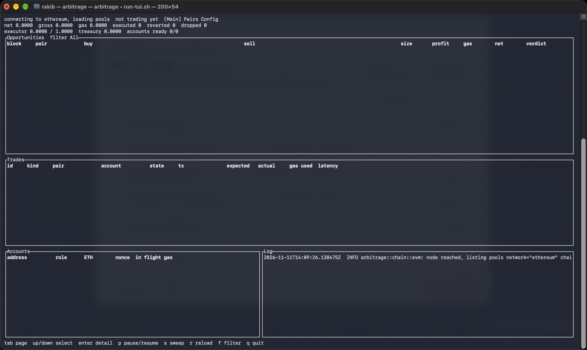
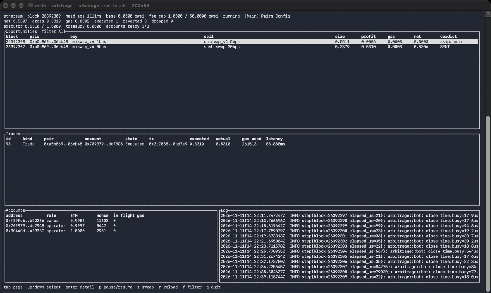
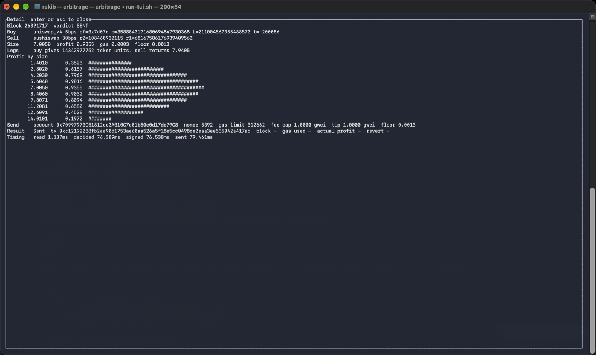
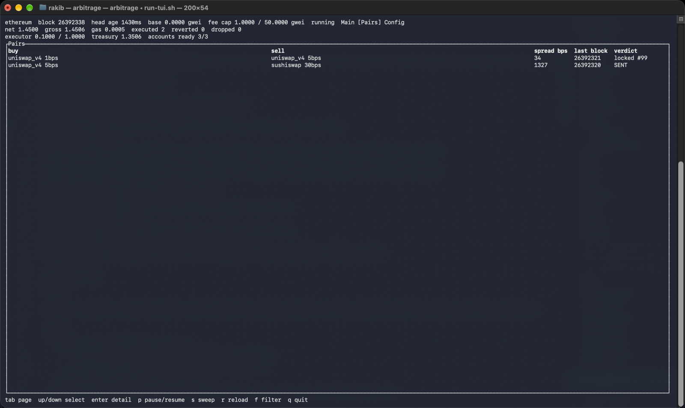
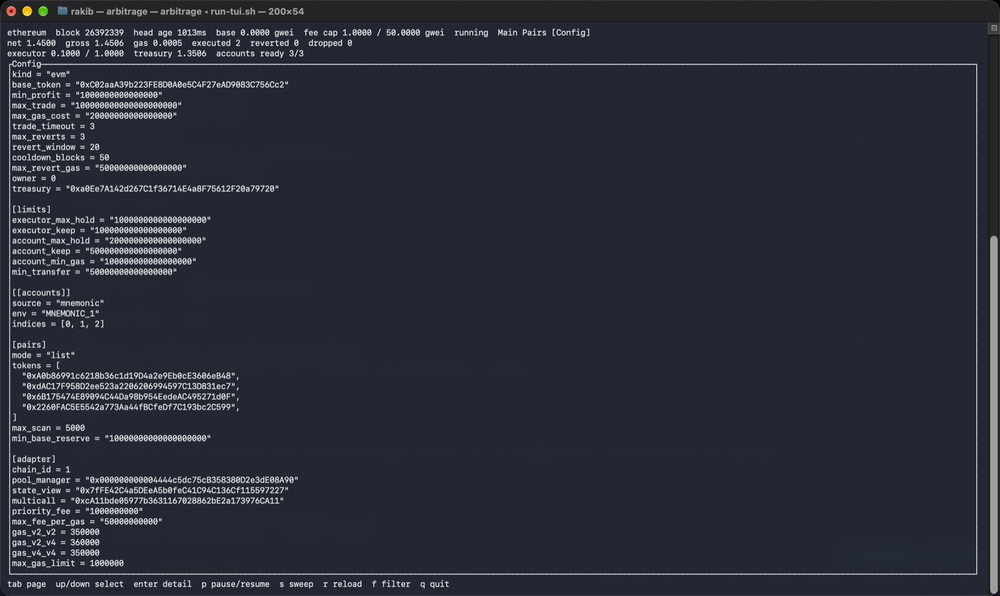

[](https://techforpalestine.org/learn-more)

# Arbitrage Bot

A flash-loan arbitrage bot for Uniswap V4, Uniswap V2 and SushiSwap. It watches pools for price gaps and trades them through one executor contract, on a local anvil fork of mainnet. A terminal UI shows each decision and trade.

## Screenshots

Captured from a live fork run.



The main screen after two executed trades, +0.5310 and +0.9195 ETH. The executor swept 1.3506 ETH to the treasury. The opportunities panel keeps recent decisions across blocks.



Startup: the screen shows the connect while pools load, before any trading.



The first trade, Executed.



A SENT decision: the legs, the profit by size curve, the send parameters, and timing. Decided in 76ms, sent in 79ms.



The Pairs tab.



The Config tab.

## Credentials

Mnemonic: `impose maximum pencil dragon steel kick unusual firm steak jeans snow maid`

## Development

Copy the env file first. It ships the anvil test mnemonic as `MNEMONIC_1`.

```
cp .env.example .env
```

Run it on a fork, each in its own terminal:

```
make fork
make fund
make run
```

To see a trade, push one pool off price, for example a large swap on SushiSwap's WETH/USDC pair from another anvil account.

Make targets:

- `make setup` installs Foundry and forge-std.
- `make abi` builds the contract and copies its ABI to `abi/`.
- `make test-contracts` runs the forge tests against `FORK_URL`.
- `make fork` starts anvil as a mainnet fork, one block every 2 seconds.
- `make refork` resets the running anvil to the current mainnet head.
- Neither echoes `FORK_URL`, which usually holds a provider key, but anvil prints its fork URL in its startup banner, so keep that terminal's output private.
- `make fund` funds the configured accounts with ETH and tokens on the fork.
- `make sweep` sends the executor's base token profit to the treasury.
- `make journal` prints the last 20 trade journal entries.
- `make run` starts the bot with the terminal UI.
- `make run-headless` starts the bot without the UI.
- `make test` runs the unit tests. It needs no network.
- `make test-fork` runs the fork tests.
- `make bench` runs the benchmarks.
- `make lint` runs `cargo fmt --check` and clippy.
- `make teardown` removes the Foundry install that `make setup` added.

After `make teardown`, run `make setup` again before any fork target.

The first `make run` connects slowly, a few minutes, while pool state loads.

### Fork tests

`make test-fork` starts its own anvil on port 8546, pinned to a block. It stops it when the tests end.

The first run fetches state from the public RPC and takes about 16 minutes. A repeat run on the cached block takes about 72 seconds. Plain `make test` stays hermetic.

### Config

Each network has a file in `config/`. Keys below are from `config/ethereum.toml`.

- Accounts: each `[[accounts]]` entry names an env var, such as `MNEMONIC_1`, and the `indices` to derive. `owner` is the index that deploys the executor. `treasury` is a plain address.
- Gas caps: `max_gas_cost` at the top level, `max_fee_per_gas`, `priority_fee` and the gas limits (`gas_v2_v2`, `gas_v2_v4`, `gas_v4_v4`, `max_gas_limit`) under `[adapter]`.
- Journal: trades are written to `logs/trades-<network>.jsonl`. Read it with `make journal`.

### Adding a network

Copy `config/ethereum.toml` and edit it. Run with `NETWORK=<name>`.

### Adding a DEX family

1. Add a venue in `src/chain/evm/venue`.
2. Add a library in `contracts/legs`.
3. Add a `Family` variant.
